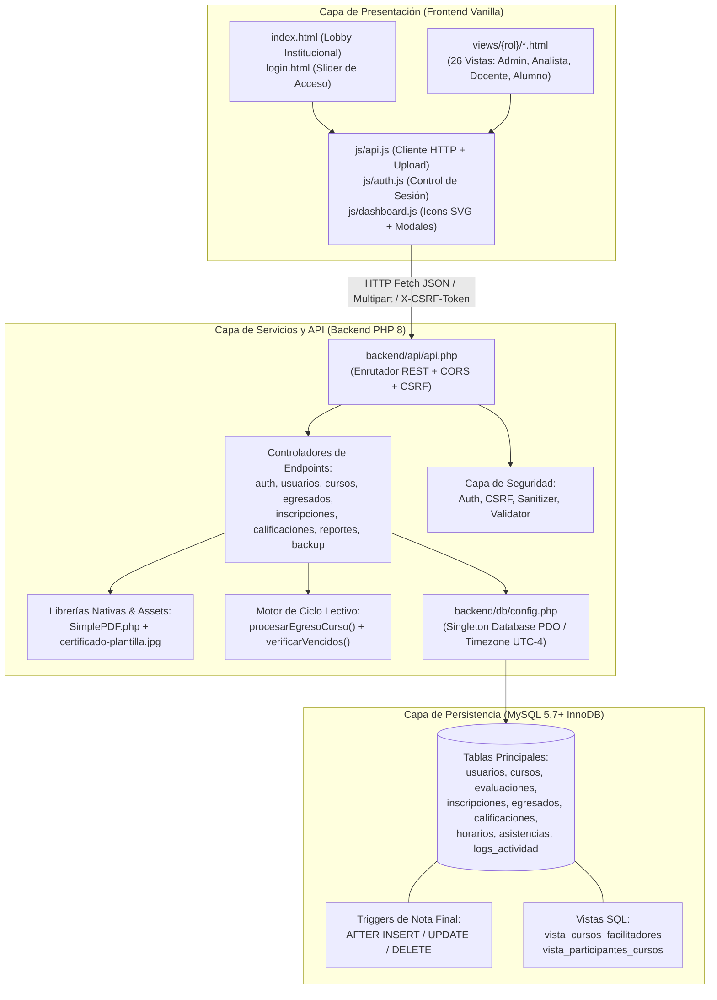
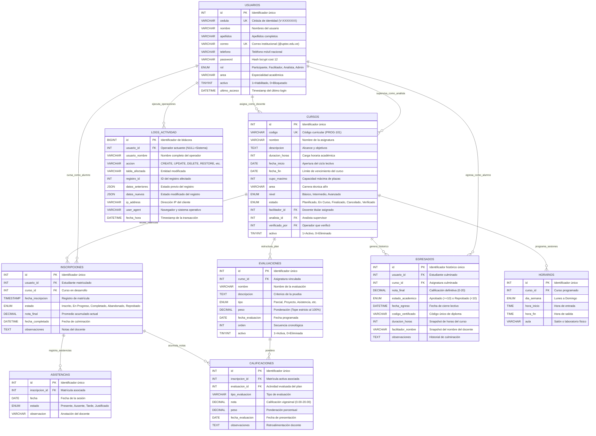
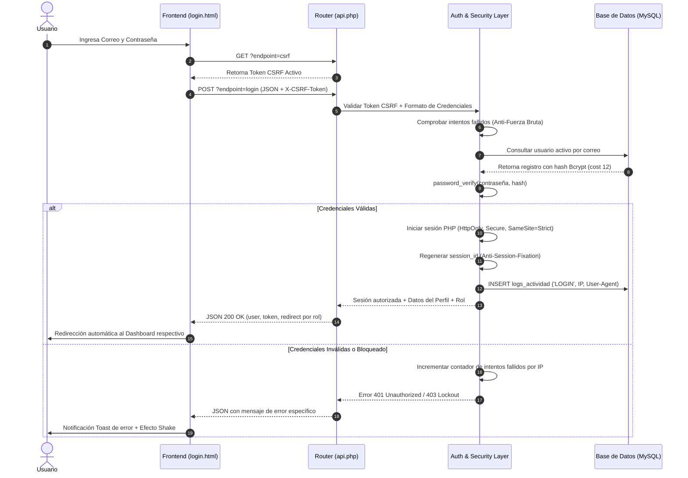
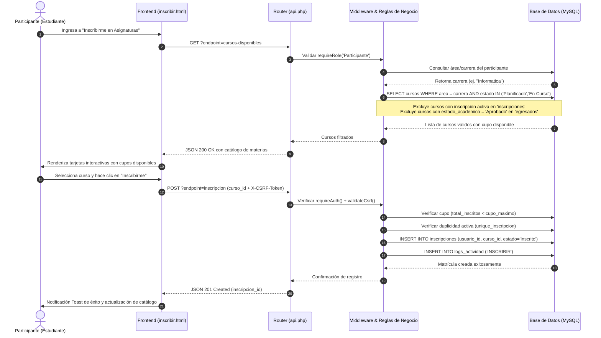
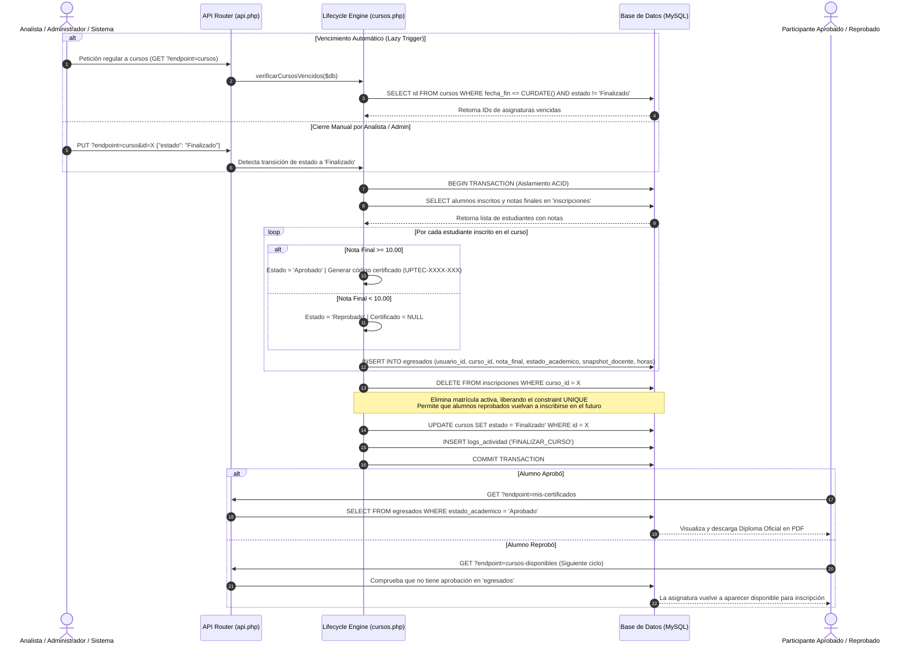

# START OF FILE `08-diagramas.md`

# Diagramas del Sistema

## UPTECMS Cursos v2.0 - Especificación Gráfica y Diagramas de Flujo

---

## 1. Arquitectura General del Sistema

El sistema implementa una **arquitectura monolítica modular por capas** con estricta política de **cero dependencias externas (Zero-Dependencies)**. Todas las peticiones del frontend se canalizan a través de un único punto de entrada RESTful (`api.php`) que orquesta la autenticación, validación, persistencia en base de datos y la generación binaria de documentos oficiales (PDF y SQL).




---

## 2. Diagrama Entidad-Relación (ER)

Este diagrama representa el modelo relacional completo de **UPTECMS Cursos**, incluyendo la entidad histórica **`EGRESADOS`**, la precisión decimal corregida en **`EVALUACIONES`** (`DECIMAL(5,2)`), la auditoría transaccional y la liberación de la clave única de matrícula.




---

## 3. Flujo de Autenticación y Autorización (Security Flow)

Este flujo ilustra el protocolo de acceso seguro implementado en `login.html`, `auth.php` y `csrf.php`:




---

## 4. Flujo de Consulta e Inscripción Curricular

Este flujo describe cómo un participante explora asignaturas de su carrera, validando cupos y excluyendo materias aprobadas previamente en `egresados`:




---

## 5. Flujo del Ciclo de Cierre Lectivo y Transición a Egresados (Nuevo)

Este diagrama documenta la arquitectura de **cierre automático y manual de asignaturas**, la consolidación de notas, la expulsión de la matrícula activa y la habilitación de re-inscripción:



---

## 6. Flujo de Restauración Segura de Base de Datos (Nuevo)

Este diagrama detalla el protocolo de subida `multipart/form-data`, verificación heurística, aislamiento de claves foráneas y ejecución en bloque del módulo de respaldo:

```mermaid
sequenceDiagram
    autonumber
    actor Admin as Administrador del Sistema
    participant Front as Frontend (backup.html)
    participant Client as Cliente HTTP (api.js - upload)
    participant Router as API Router (api.php)
    participant Backend as Controlador (backup.php)
    participant DB as Motor MySQL (uptec_cursos)

    Admin->>Front: Selecciona archivo local de respaldo (.sql)
    Front->>Front: Muestra Modal de Confirmación y Advertencia Crítica (Icons.alerta)
    Admin->>Front: Pulsa "Confirmar y Restaurar"
    Front->>Client: API.upload('restore', formData)
    Client->>Router: POST ?endpoint=restore (multipart/form-data + X-CSRF-Token)
    
    Router->>Backend: Validar requireAdmin() + validateCsrf()
    Backend->>Backend: 1. Validar transmisión sin errores (UPLOAD_ERR_OK)
    Backend->>Backend: 2. Validar tamaño máximo (file_size <= 25 MB)
    Backend->>Backend: 3. Validar extensión obligatoria (.sql)
    Backend->>Backend: 4. Inspección heurística de contenido (CREATE, INSERT, DROP)
    
    Backend->>Backend: Ampliar límites: set_time_limit(300), memory_limit(256M)
    Backend->>DB: SET FOREIGN_KEY_CHECKS = 0; (Desactivar integridad temporalmente)
    
    loop Por cada lote de sentencias SQL delimitadas
        Backend->>DB: $db->exec($queryLote)
    end
    
    Backend->>DB: SET FOREIGN_KEY_CHECKS = 1; (Reactivar integridad referencial)
    Backend->>DB: INSERT INTO logs_actividad ('RESTORE', total_sentencias, archivo)
    
    Backend-->>Router: JSON 200 OK ("Base de datos restaurada exitosamente")
    Router-->>Client: Respuesta procesada
    Client-->>Front: Notificación Toast de éxito
    Front->>Admin: Recarga automática del navegador para sincronizar esquema
```

---

## 7. Notas Técnicas de los Diagramas

1. **Gestión de Sesión y Autenticación:** El sistema no utiliza tokens JWT en LocalStorage para autorización sensible. El token devuelto en el login es complementario; la autorización real reside en **sesiones seguras de PHP en el servidor** protegidas con flags `HttpOnly`, `SameSite=Strict` y cabeceras `X-CSRF-Token` validadas por middleware.
2. **Cliente HTTP Centralizado:** Todo el tráfico del frontend fluye a través de `frontend/js/api.js`. Este módulo abstrae la inyección del token CSRF, serializa peticiones JSON, maneja flujos multipart para subida de archivos y captura respuestas HTML anómalas arrojando mensajes legibles en la interfaz.
3. **Persistencia Transaccional:** Todas las operaciones de múltiples pasos (cierre de cursos, egreso de alumnos, actualización de planes con dependencias) se ejecutan dentro de bloques `try { $db->beginTransaction(); ... $db->commit(); } catch { $db->rollBack(); }` garantizando consistencia atómica.
4. **Métricas en Tiempo Real:** El cálculo de notas no depende de tareas asíncronas ni de cálculos manuales de interfaz; los triggers de MySQL (`actualizar_nota_final_inscripcion`) actualizan la ponderación vigesimal inmediatamente después de cada sentencia `INSERT`, `UPDATE` o `DELETE` sobre la tabla `calificaciones`.

---
# END OF FILE `08-diagramas.md`